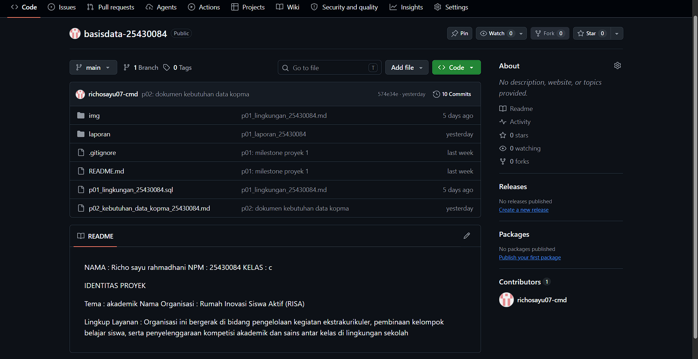
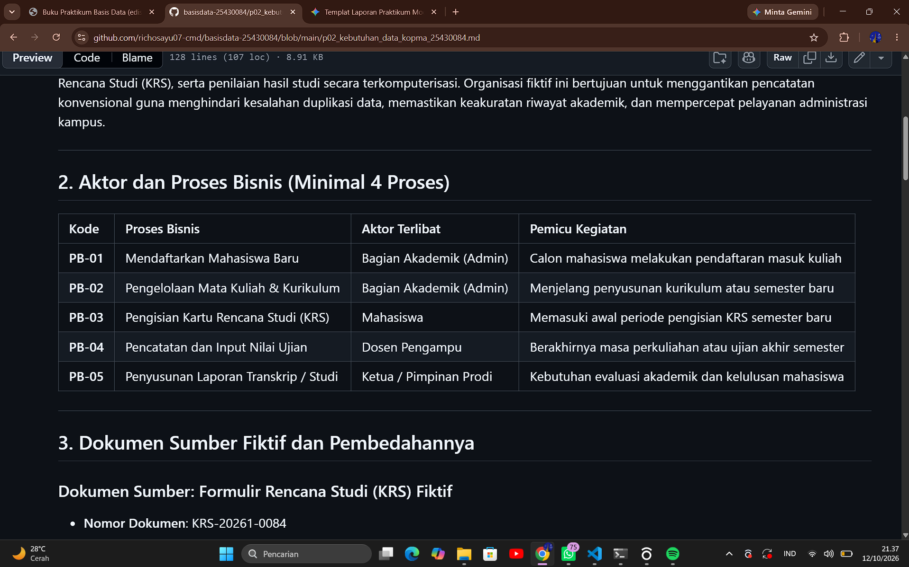
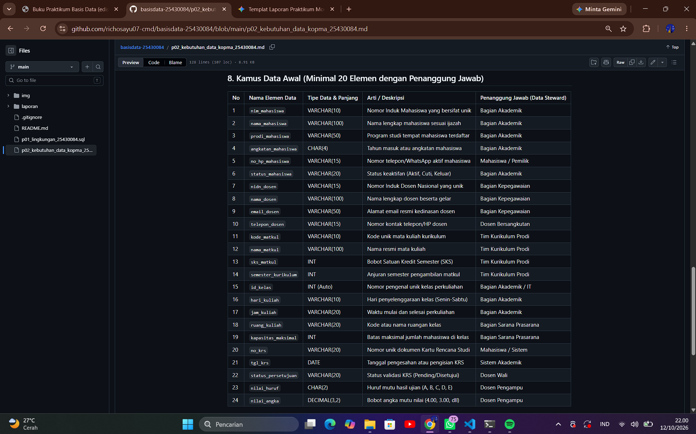

# LAPORAN PRAKTIKUM MODUL 2
## ANALISIS DAN PERANCANGAN KEBUTUHAN DATA BASIS DATA

| Parameter Identitas | Data Mahasiswa & Proyek |
| :--- | :--- |
| **Nama Mahasiswa** | Richo Sayu Rahmadani |
| **NPM** | 25430084 |
| **Kelas** | C |
| **Tema Proyek** | Akademik |
| **Nama Organisasi** | Rumah Inovasi Siswa Aktif (RISA) |
| **Parameter P** | **46** *(Rumus: $P = 40 + (84 \bmod 7) = 46$)* |

---

## 1. PENDAHULUAN & TITIK ANALISIS (1–3)

Laporan praktikum ini menyajikan hasil analisis kebutuhan data pada **Rumah Inovasi Siswa Aktif (RISA)** yang mencakup 3 titik analisis utama:

1. **Titik Analisis 1: Identifikasi Aktor & Proses Bisnis (PB)**
   * Mengidentifikasi 4 aktor utama (*Siswa*, *Pembina*, *Panitia Kompetisi*, dan *Pengurus RISA*).
   * Merumuskan 6 Proses Bisnis utama (**PB-01** Pendaftaran Ekstrakurikuler, **PB-02** Pembentukan Kelompok Belajar, **PB-03** Penyelenggaraan Kompetisi Sains, **PB-04** Pencatatan Presensi & Aktivitas, **PB-05** Penilaian & Input Skor, serta **PB-06** Pelaporan Prestasi & Rekapitulasi).

2. **Titik Analisis 2: Analisis & Pembedahan Dokumen Sumber Fiktif**
   * Merancang dan membedah dokumen sumber *Formulir Pendaftaran & Hasil Kompetisi Sains RISA* ke dalam 4 kelompok elemen data: Identitas Transaksi, Data Peserta & Tim, Data Lomba/Kompetisi, dan Atribut Turunan (*Calculated Attribute*: `total_skor_tim`).

3. **Titik Analisis 3: Entitas Kandidat, Matriks CRUD, & Kamus Data**
   * Menentukan 6 Entitas Kandidat: `Siswa`, `Pembina`, `Ekstrakurikuler`, `Kelompok_Belajar`, `Kompetisi_Sains`, dan `Pendaftaran_Hasil`.
   * Merumuskan Matriks CRUD 6x6 dan Kamus Data Awal berisi 25 elemen data beserta penetapan *Data Steward*.

---

## 2. BUKTI TANGKAPAN LAYAR GITHUB (EVIDENCE)

Seluruh berkas analisis kebutuhan data (`p02_kebutuhan_data_kopma_25430084.md` / `p02_kebutuhan_data_25430084.md`) telah diunggah dan dirender secara sempurna pada repositori GitHub.

### 2.1 Repositori Utama di GitHub

![Screenshot 1: Landing Page Repositori GitHub]
 
*Gambar 2.1: Tampilan Landing Page Repositori Proyek di GitHub*

---

### 2.2 Tabel Proses Bisnis (PB)
   
*Gambar 2.2: Tangkapan Layar Tabel Proses Bisnis (PB) di GitHub*

---

### 2.3 Aturan Bisnis (AB) dan Kebutuhan Informasi (KI)  
  
    
*Gambar 2.5: Tangkapan Layar Kamus Data Awal di GitHub*

---

## 3. PARAMETER P & PERBAIKAN KEBUTUHAN KABUR

### 3.1 Perhitungan Parameter P
Parameter $P$ dihitung secara otomatis berdasarkan 2 digit terakhir NPM (25430084):
$$\text{Digit Terakhir NPM} = 84$$
$$P = 40 + (84 \bmod 7) = 40 + 6 = 46$$

---

### 3.2 Perbaikan 3 Pernyataan Kebutuhan Kabur (*Ambiguous Requirements*)

Dalam perancangan awal, ditemukan 3 kebutuhan bernuansa kualitatif/ambigu yang kemudian diperbaiki menjadi spesifikasi teknis kuantitatif dan terukur menggunakan parameter $P = 46$:

| No | Pernyataan Kebutuhan Awal (Kabur / Ambigu) | Pernyataan Kebutuhan Terukur (Hasil Perbaikan) | Formulasi & Dasar Perhitungan ($P = 46$) |
| :-: | :--- | :--- | :--- |
| **1** | *"Kapasitas anggota kelompok belajar dibatasi agar kelas tidak terlalu padat."* | **AB-04**: Kapasitas peserta dalam satu kelompok belajar dibatasi maksimum **26 siswa/kelompok**. | $\text{Kapasitas Maks} = P - 20 = 46 - 20 = 26 \text{ siswa}$ |
| **2** | *"Sistem harus mampu menangani beban pendaftaran harian dengan lancar."* | **Kebutuhan Non-Fungsional**: Sistem wajib mampu menangani beban transaksi puncak hingga **270 pendaftaran/hari**. | $\text{Volume Harian} = 40 + (5 \times P) = 40 + (5 \times 46) = 270 \text{ transaksi/hari}$ |
| **3** | *"Siswa bebas memilih kegiatan ekstrakurikuler yang disukai di sekolah."* | **AB-03**: Siswa diperbolehkan mendaftar dan mengikuti **maksimal 3 kegiatan** (ekstrakurikuler/kelompok) secara bersamaan. | Menjaga keseimbangan beban belajar dan fokus akademik siswa. |

---

## 4. KESIMPULAN

1. Seluruh **Titik Analisis 1–3** telah diselesaikan dengan membentuk 6 Proses Bisnis, pembedahan formulir sumber fiktif, serta penyusunan 6 entitas kandidat.
2. Parameter $P = 46$ berhasil diintegrasikan secara presisi untuk membatasi kapasitas kelompok belajar (26 siswa) dan mengestimasi beban transaksi puncak (270 pendaftaran/hari).
3. Tiga pernyataan kebutuhan yang ambigu telah diperbaiki menjadi spesifikasi terukur dan kuantitatif.
4. Seluruh hasil perancangan telah terverifikasi melalui Matriks CRUD dan Kamus Data Awal (25 elemen data beserta *Data Steward*) tanpa adanya entitas mati (*unreferenced entity*).