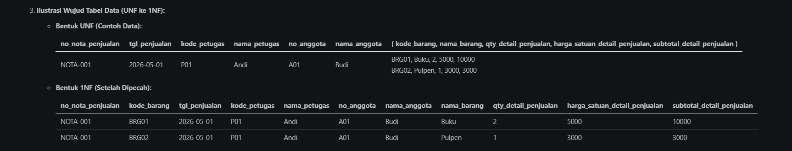

# Laporan Praktikum Basis Data - Modul 4: Normalisasi Basis Data
**Nama:** Richo Sayu Rahmadani  
**NIM:** 25430084  
**Kelas:** C  
**Program Studi:** S1 Ilmu Komputer  
**Instansi:** Universitas Muhammadiyah Metro  
**Tanggal:** 19 Oktober 2026  

---

## 1. Tujuan Praktikum
Praktikum Modul 4 ini dirancang untuk memberikan pemahaman mendalam serta keterampilan praktis dalam menerapkan teknik **Normalisasi Basis Data** pada dokumen dunia nyata. Secara spesifik, tujuan praktikum ini mencakup:
1. Memahami konsep ketergantungan fungsional (*Functional Dependency / FD*) dan perannya sebagai dasar teoritis pembentukan struktur relasi basis data yang efisien.
2. Mampu mentransformasikan dokumen sumber mentah (bentuk tidak ternormalisasi / *Unnormalized Form* / UNF) menjadi bentuk relasi atomik pada Bentuk Normal Pertama (1NF).
3. Mampu mengidentifikasi dan mengeliminasi ketergantungan parsial (*Partial Dependency*) untuk mencapai Bentuk Normal Kedua (2NF).
4. Mampu mengidentifikasi dan mengeliminasi ketergantungan transitif (*Transitive Dependency*) untuk mencapai Bentuk Normal Ketiga (3NF).
5. Mampu melakukan evaluasi teknis terhadap syarat *Boyce-Codd Normal Form* (BCNF) guna memastikan bahwa setiap determinan pada seluruh relasi merupakan *Candidate Key* / *Super Key*.
6. Mampu menganalisis keberadaan nilai turunan (*Derived Attributes*) dan mengambil keputusan arsitektural mengenai kapan suatu atribut wajib disimpan secara historis versus dihitung secara dinamis (*on-the-fly*).
7. Mampu merancang skema relasional kanonik yang bersih untuk sistem akademik KRS/Transkrip Nilai mahasiswa (`25430084`) sebagai acuan skrip DDL (*Data Definition Language*) pada Pertemuan 5.

---

## 2. Ringkasan Dasar Teori

### A. Konsep Normalisasi dan Anomali Data
Normalisasi adalah proses formal perancangan basis data relasional dengan cara mengelompokkan atribut-atribut data ke dalam relasi-relasi terpisah guna meminimalkan redundansi data dan mencegah terjadinya anomali manipulasi data, yaitu:
* **Anomali Penyisipan (*Insertion Anomaly*):** Ketidakmampuan untuk memasukkan suatu data entitas baru tanpa harus memasukkan data entitas lain yang belum ada atau tidak relevan.
* **Anomali Pembaruan (*Update Anomaly*):** Ketidakinkonsistensian data yang terjadi ketika perubahan pada satu baris data memerlukan pembaruan berulang pada banyak baris data lainnya di seluruh basis data.
* **Anomali Penghapusan (*Deletion Anomaly*):** Kehilangan data penting yang tidak disengaja akibat penghapusan suatu baris data tertentu.

### B. Hirarki Bentuk Normal
1. **UNF (*Unnormalized Form*):** Bentuk data mentah yang mencerminkan tampilan fisik dokumen sumber di mana satu baris/record masih memuat kelompok data berulang (*repeating group*) atau data bersarang.
2. **1NF (*First Normal Form*):** Sebuah relasi dikatakan memenuhi 1NF jika dan hanya jika setiap atributnya bernilai atomik (tidak dapat dibagi lagi) dan tidak ada lagi kelompok data yang berulang. Pada tahap ini, kunci primer (*Primary Key*) umumnya terbentuk dari gabungan beberapa atribut (*Composite Key*).
3. **2NF (*Second Normal Form*):** Memenuhi syarat 1NF dan seluruh atribut non-kunci memiliki ketergantungan fungsional penuh (*Full Functional Dependency*) terhadap kunci primer. Artinya, tidak boleh ada ketergantungan parsial (*Partial Dependency*), yaitu atribut non-kunci yang hanya bergantung pada sebagian dari kunci komposit.
4. **3NF (*Third Normal Form*):** Memenuhi syarat 2NF dan tidak memuat ketergantungan transitif (*Transitive Dependency*), yaitu situasi di mana atribut non-kunci bergantung pada atribut non-kunci lainnya ($A \rightarrow B$ dan $B \rightarrow C$, sehingga $A \rightarrow C$).
5. **BCNF (*Boyce-Codd Normal Form*):** Bentuk normal yang lebih ketat dibandingkan 3NF. Sebuah relasi memenuhi BCNF jika untuk setiap ketergantungan fungsional $X \rightarrow Y$, atribut $X$ wajib merupakan kunci super (*Super Key*) atau kunci kandidat (*Candidate Key*).

### C. Analisis Atribut Turunan (*Derived Attributes*)
Atribut turunan adalah atribut yang nilainya dapat dihasilkan/dihitung dari atribut lain yang ada di dalam basis data (seperti total SKS, Indeks Prestasi Semester/IPS, atau subtotal harga). Prinsip perancangan basis data modern menyatakan bahwa atribut turunan idealnya **tidak disimpan secara fisik** guna mencegah redundansi dan anomali pembaruan. Namun, atribut turunan yang bersifat **historis** (seperti nilai huruf atau bobot mutu pada transkrip) wajib disimpan secara permanen apabila aturan atau skala konversinya berpotensi berubah di masa depan.

---

## 3. Bukti Tangkapan Layar

### Bukti Tangkapan Layar Tabel Tahapan UNF → 1NF → 2NF → 3NF
Berikut adalah bukti visual transformasi struktur data dari bentuk awal (*Unnormalized Form*) hingga terdekomposisi sempurna menjadi tabel-tabel terpisah pada tahap 1NF, 2NF, dan 3NF:

*Keterangan Gambar:* Tangkapan layar di atas memperlihatkan perbandingan bentuk tabel data UNF (yang memuat data berulang `{ ... }`), hasil pemecahan baris atomik pada 1NF, serta struktur relasi tabel master dan transaksional hasil pemisahan ketergantungan parsial (2NF) dan ketergantungan transitif (3NF).

---

## 4. Analisis Wajib

### A. Daftar Dependensi Fungsional (FD) Sistem Akademik KRS/Transkrip (NIM: 25430084)
Berdasarkan aturan bisnis domain akademik Universitas Muhammadiyah Metro, rumusan ketergantungan fungsional (*Functional Dependencies*) dirumuskan secara rinci sebagai berikut:

* **FD1 (Header Transaksi KRS):**  
  `no_krs -> tgl_krs, thn_akademik, nim_mahasiswa`  
  *Penjelasan:* Setiap lembar KRS memiliki nomor unik (`no_krs`) yang secara pasti menentukan tanggal pengisian, tahun akademik berjalan, dan identitas mahasiswa pemilik KRS.

* **FD2 (Master Mahasiswa):**  
  `nim_mahasiswa -> nama_mahasiswa, prodi_mahasiswa, kode_dosen_pa`  
  *Penjelasan:* Nomor Induk Mahasiswa (`nim_mahasiswa`) bersifat unik untuk setiap mahasiswa dan menentukan nama lengkap, program studi, serta dosen pembimbing akademik (PA) yang diampu.

* **FD3 (Master Dosen Pembimbing Akademik):**  
  `kode_dosen_pa -> nama_dosen_pa`  
  *Penjelasan:* Kode unik dosen (`kode_dosen_pa`) secara mutlak menentukan nama lengkap dosen pembimbing akademik.

* **FD4 (Master Mata Kuliah):**  
  `kode_mk -> nama_mk, sks, semester_mk`  
  *Penjelasan:* Kode mata kuliah (`kode_mk`) menentukan judul/nama mata kuliah, bobot SKS, serta alokasi semester standar dalam kurikulum.

* **FD5 (Pengambilan Matkul & Penilaian Transaksional):**  
  `(no_krs, kode_mk) -> kelas, nilai_angka, nilai_huruf, bobot_nilai`  
  *Penjelasan:* Pengambilan suatu mata kuliah tertentu pada nomor KRS tertentu menentukan kelas yang diikuti serta hasil penilaian berupa nilai angka, nilai huruf, dan bobot mutu yang diperoleh mahasiswa.

* **FD6 (Aturan Konversi Nilai Akademik):**  
  `nilai_angka -> nilai_huruf, bobot_nilai`  
  *Penjelasan:* Nilai akhir dalam bentuk numerik menentukan konversi nilai huruf (misal: A, B+, C) dan bobot mutunya (misal: 4.00, 3.50, 2.00) berdasarkan standar penilaian akademik.

### B. Keputusan Menyimpan atau Menghitung Nilai Turunan (*Derived Attributes*) Beserta Alasannya

| Atribut Turunan | Status Penyimpanan | Jenis Kalkulasi / Alasan Teknis & Akademik |
| :--- | :--- | :--- |
| **`total_sks`** | **TIDAK DISIMPAN** | **Dihitung secara Dinamis (*On-The-Fly*).** Atribut ini merupakan akumulasi dari penjumlahan SKS mata kuliah yang diambil (`SUM(mata_kuliah.sks)`). Menyimpan `total_sks` secara permanen pada tabel `krs` akan memicu anomali pembaruan apabila mahasiswa melakukan penambahan atau pembatalan (*drop*) mata kuliah. |
| **`ips` (Indeks Prestasi Semester)** | **TIDAK DISIMPAN** | **Dihitung secara Dinamis melalui *Query / View*.** Nilai IPS dihitung dengan rumus: $\frac{\sum (\text{SKS} \times \text{Bobot})}{\sum \text{SKS}}$. Nilai ini cukup dikalkulasi saat pencetakan KHS/Transkrip menggunakan kueri SQL agregasi untuk menjamin konsistensi data. |
| **`sks_x_bobot`** | **TIDAK DISIMPAN** | **Dihitung secara Dinamis.** Merupakan hasil perkalian langsung antara bobot SKS mata kuliah dengan bobot mutu nilai. Tidak perlu disimpan di basis data fisik karena mudah dihitung dalam kueri laporan. |
| **`nilai_huruf` & `bobot_nilai`** | **TETAP DISIMPAN** | **Disimpan secara Permanen di `detail_krs`.** Meskipun nilai huruf dan bobot dapat diturunkan dari `nilai_angka` (FD6), aturan/skala konversi nilai lembaga pendidikan dapat berubah sewaktu-waktu antar tahun ajaran. Menyimpan atribut ini secara eksplisit menjaga **integritas histori akademik**, sehingga nilai mahasiswa di masa lalu tidak berubah akibat penyesuaian aturan di masa depan. |

---

## 5. Hasil Latihan, Modifikasi, & Ringkasan Berkas Proyek Mandiri

Rancangan normalisasi proyek mandiri mahasiswa telah disusun secara utuh pada berkas terpisah **`p04_normalisasi_25430084.md`**. Hasil akhir dekomposisi relasi 3NF / BCNF membentuk skema kanonik 5 tabel sebagai berikut:

### Tabel Skema Kanonik Proyek Akademik (`25430084`)

| Nama Tabel | Kunci Primer (*Primary Key*) | Kunci Unik (*Unique Key*) | Kunci Tamu (*Foreign Key*) |
| :--- | :--- | :--- | :--- |
| **`dosen`** | `id_dosen` | `kode_dosen_pa` | – |
| **`mahasiswa`** | `id_mahasiswa` | `nim_mahasiswa` | `id_dosen` (merujuk ke `dosen.id_dosen`) |
| **`krs`** | `id_krs` | `no_krs` | `id_mahasiswa` (merujuk ke `mahasiswa.id_mahasiswa`) |
| **`mata_kuliah`** | `id_mk` | `kode_mk` | – |
| **`detail_krs`** | (`id_krs`, `id_mk`) | – | `id_krs` (ke `krs`), `id_mk` (ke `mata_kuliah`) |

---

## 6. Pembahasan dan Kendala

Selama pelaksanaan praktikum Modul 4 ini, beberapa analisis teknis dan kendala yang dihadapi antara lain:
1. **Ketelitian Memetakan Ketergantungan Fungsional:** Mengidentifikasi determinan pada tabel berukuran besar memerlukan analisis aturan bisnis yang cermat. Kesalahan dalam menentukan apakah suatu atribut bergantung secara penuh atau parsial dapat menyebabkan kesalahan struktur tabel pada tahap 2NF.
2. **Transformasi Kunci Komposit ke *Surrogate Key*:** Pada tahap 3NF dan BCNF, kunci komposit alami (seperti gabungan `no_krs` dan `kode_mk`) ditransformasikan menjadi kunci pengganti (*Surrogate Key*) berupa tipe data integer auto-increment (`id_krs`, `id_mk`). Hal ini sangat bermanfaat untuk meningkatkan efisiensi indeksasi dan kecepatan pencarian data pada implementasi skrip DDL Pertemuan 5.

---

## 7. Kesimpulan
1. Proses normalisasi basis data berhasil diterapkan secara sistematis mulai dari bentuk mentah (UNF), 1NF, 2NF, 3NF, hingga BCNF pada dokumen akademik Kartu Rencana Studi (KRS) dan Transkrip Nilai.
2. Seluruh ketergantungan parsial dan transitif telah dieliminasi, menghasilkan skema relasional kanonik 5 tabel (`dosen`, `mahasiswa`, `krs`, `mata_kuliah`, `detail_krs`) yang terbebas dari anomali penyisipan, pembaruan, dan penghapusan.
3. Atribut turunan yang bersifat kalkulatif (`total_sks`, `ips`) diputuskan untuk dihitung secara dinamis via kueri SQL, sedangkan atribut turunan historis (`nilai_huruf`, `bobot_nilai`) tetap disimpan secara permanen demi menjamin integritas rekam jejak akademik.

---

## 8. Pernyataan Penggunaan AI
Dalam penyusunan laporan ini, instrumen AI (Google Gemini) digunakan untuk membantu merumuskan penjelasan teoritis normalisasi, memvalidasi sintaks Dependensi Fungsional (FD1–FD6), serta merapikan format tata letak dokumen laporan ke dalam standar Markdown.

---

## 9. Bukti Git & Tautan Repositori
* **Tautan Repositori GitHub:** [https://github.com/richosayu07-cmd/basisdata-25430084](https://github.com/richosayu07-cmd/basisdata-25430084)
* **Pesan Commit:** `p04: normalisasi kopma dan milestone proyek 4` / `p04: perbarui milestone proyek 4 normalisasi krs`

---

## 10. Checklist Khusus Laporan Pertemuan 4

| Jenis | Yang harus ada | Status |
| :--- | :--- | :---: |
| **Berkas wajib** | `p04_normalisasi_25430084.md` (proyek) | ✔️ Terpenuhi |
| **Bukti tangkapan layar** | Tabel tahapan UNF − 1NF − 2NF − 3NF | ✔️ Terpenuhi |
| **Analisis wajib** | Daftar dependensi fungsional; keputusan menyimpan atau menghitung nilai turunan beserta alasannya | ✔️ Terpenuhi |